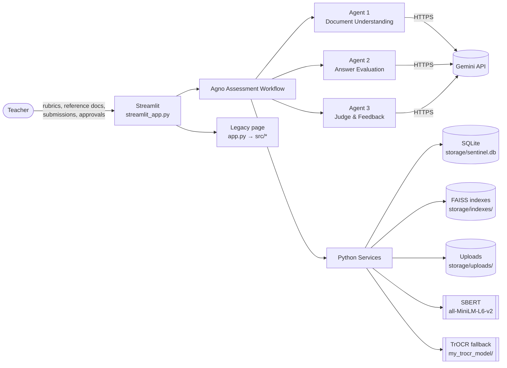
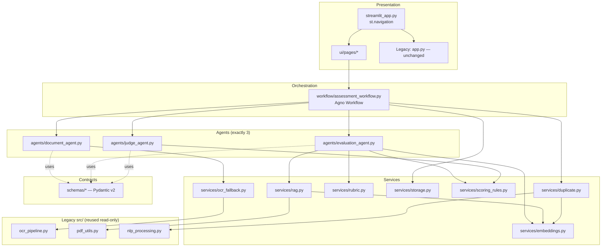
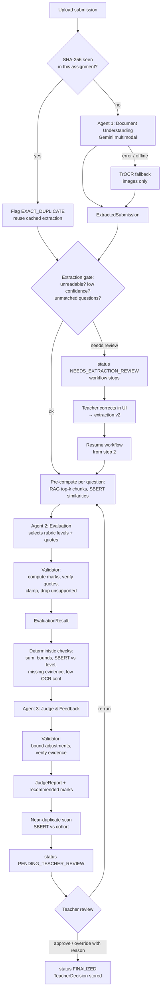
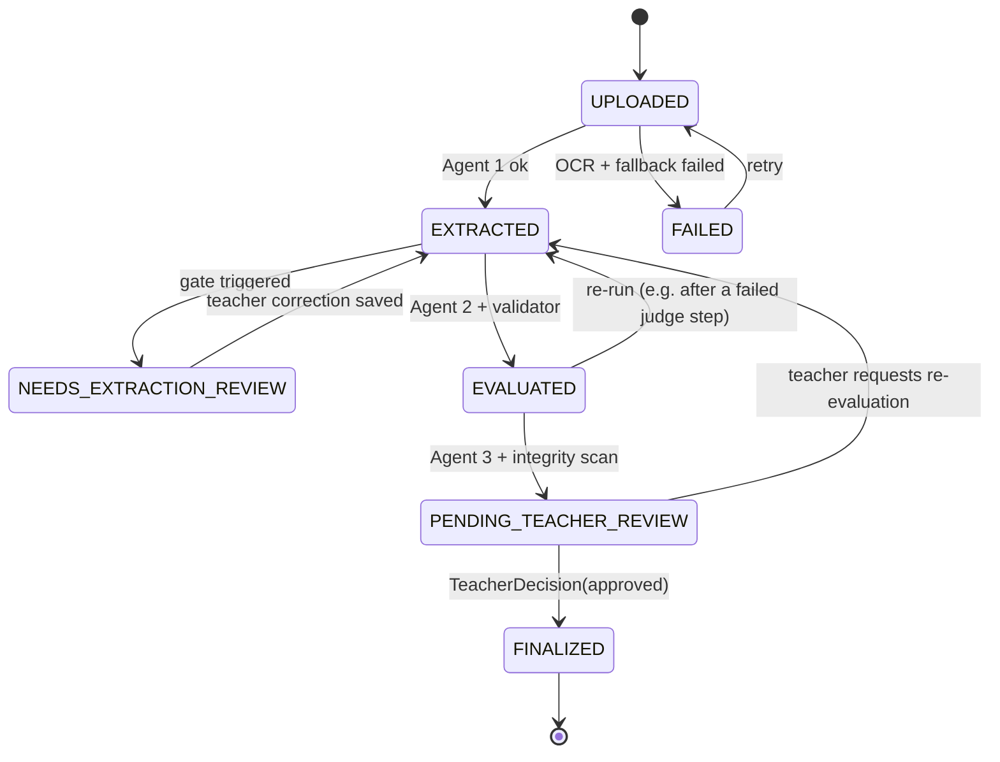
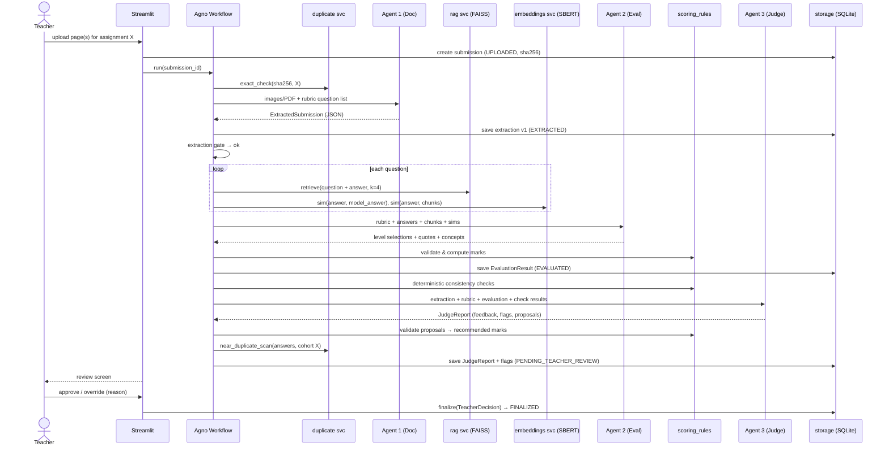
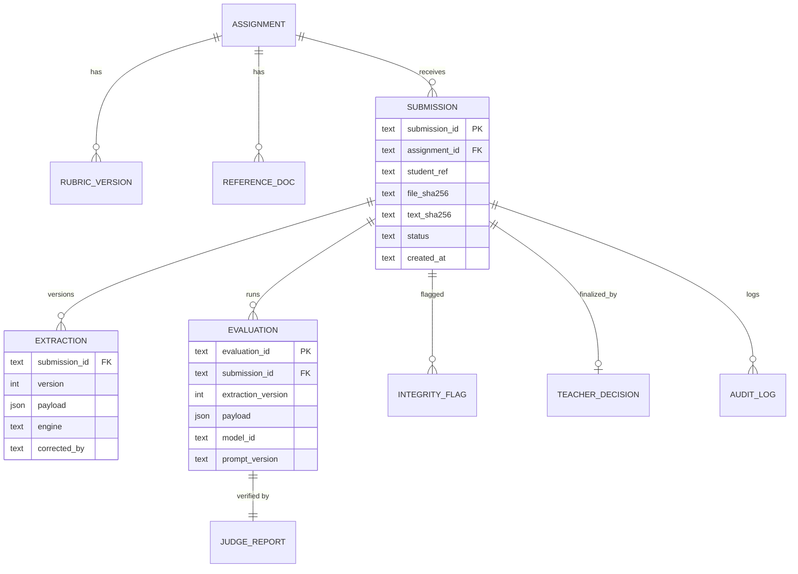

# SentinelEdu — Architecture

Companion to [`SENTINELEDU_MASTER_PLAN.md`](SENTINELEDU_MASTER_PLAN.md). The rationale for each choice is in [`SENTINELEDU_DECISIONS.md`](SENTINELEDU_DECISIONS.md).

> **API note.** Verified in Phase 2 against Agno 3.2.0 and google-genai 3.3.0 (see DECISIONS D-02 addendum). The shapes below hold.

---

## 1. System Context



---

## 2. Layered View



**Dependency rules**
- `ui` → `workflow` → `agents`/`services` → `schemas`. Lower layers never import upward.
- Agents never touch SQLite directly. The workflow persists their outputs through `services/storage.py`.
- `sentineledu/*` may import `src.ocr_pipeline`, `src.pdf_utils` and `src.nlp_processing`. It must **never** import `src.agent_verifier` (loads a model on import and awards unsupported marks) or `src.similarity` (loads a model on import; replaced by the lazy `services/embeddings.py` using the same model).

---

## 3. End-to-End Workflow



### 3.1 Status machine



`FINALIZED` can only be reached through `storage.finalize(decision: TeacherDecision)`. No agent or workflow step calls it.

### 3.2 Sequence (happy path)



---

## 4. Agents

All three are `agno.agent.Agent` instances using `agno.models.google.Gemini` with a Pydantic `output_schema`, so each returns a validated object rather than free text. Prompts live in `sentineledu/agents/prompts/*.md` and are versioned. Every saved output records the prompt version.

### 4.1 Agent 1 — Document Understanding

| | |
|---|---|
| Input | Submission files (images via `agno.media.Image`, PDFs via `agno.media.File`), plus the list of expected questions (`question_id`, prompt text) from the rubric |
| Output | `ExtractedSubmission` |
| Model | `GEMINI_OCR_MODEL` (default: the current Flash-tier multimodal model, set in `.env`), temperature 0 |
| Responsibilities | Transcribe verbatim (no spelling fixes). Split text into answers per `question_id`. Mark illegible spans as `[[ILLEGIBLE]]`. Set a legibility rating and confidence per answer. Report missing/blank answers and diagrams/equations. Put text it cannot assign in `unmatched_text` |
| Normalisation (Python) | Student labels ("q1", "Ans 2(a)", "Question 1") are mapped to rubric IDs. Answers with labels that match no rubric question go to `unmatched_text`, so no `UNKNOWN` answers are stored. Answers split across pages are merged (worst legibility, lowest confidence, union of pages). Legibility is made consistent with the `[[ILLEGIBLE]]` markers. Questions not found are listed in `missing_question_ids` |
| Input routing (`services/documents.py`) | The format is detected from file bytes, not the extension. TIFF and other unsupported formats are converted to PNG, and images over 3072 px are downscaled. Typed PDFs (text layer of 20+ letters) are sent as text and get engine `pdf_text`. Scanned PDFs are sent as PDF parts. 20 MB inline limit |
| Fallback | If Gemini fails or `OFFLINE_MODE=true` → `services/ocr_fallback.py` calls `src.ocr_pipeline.extract_handwritten_text()` (images only) and returns one `unmatched_text` block plus its TrOCR confidence. This always triggers the extraction gate so the teacher assigns questions |
| Teacher correction | UI edits produce `ExtractedSubmission` version *n+1* with `corrected_by` set. The original is kept |

**Extraction gate (Python function step, not an agent).** The workflow stops for review if any answer has `legibility == "unreadable"`, `confidence < EXTRACTION_REVIEW_THRESHOLD` (default 0.6), `unmatched_text` is non-empty, an expected question is missing, or the fallback engine was used.

### 4.2 Agent 2 — Answer Evaluation

| | |
|---|---|
| Input | `Rubric` for the assignment. Final `ExtractedSubmission`. Per question: top-k RAG chunks (with `chunk_id`), `sbert_sim_model_answer`, and `sbert_sim_best_chunk` |
| Output (LLM) | `EvaluationDraft`: for each criterion, `selected_level_id`, `evidence_quotes[]`, `reference_chunk_ids[]`, `concepts_present[]`, `missing_concepts[]`, `incorrect_statements[]`, `rationale` |
| Output (after validator) | `EvaluationResult` with `marks` per criterion computed in Python |
| Model | `GEMINI_REASONING_MODEL`, temperature 0 |
| Design | RAG and SBERT are **pre-computed in Python and injected into the prompt**, not called as tools. This gives one deterministic, structured call per submission (or per question if the answers are long). See D-07 |
| Context (`agents/evaluation_agent.build_context`) | Per attempted question: verbatim answer, top-k chunks from `RagStore.retrieve(prompt + answer)`, `sbert_sim_model_answer` and `sbert_sim_best_chunk` from `services/embeddings.py`. Blank/unreadable/missing answers are marked not attempted and never reach the prompt. No index for the assignment → grading from the rubric alone, chunks empty |
| Prompt (`prompts/evaluation_v1.md`) | Instructions: never output marks, pick one listed `level_id`, quote exact spans, cite only provided chunk ids, scores are advisory. A worked example shows a higher level with a quote and a lowest level with the wrong claim quoted. The per-submission prompt lists each question's model answer, criteria, key concepts and levels (best first), the answer inside `<answer>` tags, chunks as `[chunk_id … | source p.N | similarity]`, and the two scores |
| Extra validator flags | `NOT_ATTEMPTED` (question), `MISSING_QUESTION`, `MISSING_CRITERION:id`, `UNKNOWN_CRITERION:id`, `NO_EVIDENCE_AT_ZERO:id` (informational), `TOTAL_CLAMPED` (defence only). See D-24 |
| Failure | Gemini error after retries, or `OFFLINE_MODE` → `EvaluationError`. There is no offline grader (D-24) |

**Validator (`services/scoring_rules.py`).**
1. `selected_level_id` must exist in the criterion's levels. If not → the lowest level, plus flag `INVALID_LEVEL`.
2. `marks = level.marks`. The LLM never supplies a number.
3. If `marks > 0`, at least one `evidence_quote` must fuzzy-match the student's answer text (`difflib.SequenceMatcher` ratio ≥ 0.85 on a sliding window). If none matches → downgrade to the lowest level, plus flag `UNSUPPORTED_EVIDENCE`.
4. `reference_chunk_ids` must be among the chunks that were provided. Unknown IDs are dropped and flagged `UNKNOWN_CITATION`.
5. Question total = Σ criterion marks ≤ `question.max_marks`. Assignment total = Σ question totals.

### 4.3 Agent 3 — Judge & Feedback

| | |
|---|---|
| Input | Extraction, rubric, `EvaluationResult`, RAG chunks, `DeterministicCheckReport` |
| Output (LLM) | `JudgeDraft`: per criterion `verdict ∈ {agree, propose_adjustment, flag}`, `proposed_level_id?`, `justification`, `evidence_quotes[]`. Per question `overlooked_concepts[]`, `feedback` (strengths, improvements, next steps). Overall `summary_feedback`, `flags[]` |
| Output (after validator) | `JudgeReport` with `recommended_marks` per criterion |
| Model | `GEMINI_REASONING_MODEL`, temperature 0. A separate system prompt makes it act as an adversarial reviewer |

**Deterministic checks (run before the Judge; results passed to it):**
`SUM_MISMATCH`, `OUT_OF_BOUNDS`, `SBERT_LEVEL_DISAGREEMENT` (e.g. SBERT ≥ 0.8 but the lowest level was chosen, or SBERT < 0.3 but the top level was chosen), `NO_EVIDENCE`, `LOW_OCR_CONFIDENCE`, `ILLEGIBLE_IN_SCORED_ANSWER`, `DIAGRAM_PRESENT`.

**Judge validator.** A proposed adjustment is accepted into `recommended_marks` only if the proposed level exists, the evidence quotes verify (or, when the proposal is a reduction, the justification cites a rubric descriptor), and the change is at most one rubric level. Otherwise the proposal is kept as a `flag` for the teacher and not applied to the recommendation. **The Judge never finalises.** Its recommendation is the default value in the teacher's review form.

**Implemented (Phase 5).** `run_checks()` also emits `VALIDATOR_DOWNGRADE` when Agent 2's output had to be corrected. `validate_judge()` adds the codes `JUDGE_ADJUSTMENT` (accepted ±1 proposal), `JUDGE_FLAG`, `JUDGE_INVALID_LEVEL`, `JUDGE_PROPOSAL_TOO_LARGE`, `JUDGE_UNSUPPORTED_PROPOSAL`, `JUDGE_PROPOSAL_NOT_ATTEMPTED`, `JUDGE_VERDICT_MISSING`, `JUDGE_UNKNOWN_ID`, `JUDGE_FEEDBACK_MISSING`; `checks_only_report()` adds `JUDGE_NOT_RUN`. The report carries `recommended_total`, `max_total`, `evaluation_total`, `model_id`, `prompt_version`, `evaluation_id`, and `recommended_marks()` returns the `question_id -> criterion_id -> marks` shape that `TeacherDecision.final_marks` uses. One Gemini call per submission (`prompts/judge_v1.md`); the prompt shows each criterion's levels in order, Agent 2's level, quotes, rationale and concept lists, the validator flags, the check flags and the reference chunks. Details in D-25.

---

## 5. Supporting Services

| Service | Module | Responsibilities | Key functions |
|---|---|---|---|
| Embeddings | `services/embeddings.py` | Lazy singleton for `all-MiniLM-L6-v2` (the same model as the legacy code, already in the HF cache). Batch encode with `normalize_embeddings=True` | `encode(texts) -> np.ndarray`, `cosine(a, b)` |
| RAG | `services/rag.py` | Ingest reference PDF/TXT (`src.pdf_utils` / pypdf). Chunk at about 500 characters with 100 overlap on sentence boundaries. One FAISS `IndexFlatIP` per assignment. Persist index and chunk metadata | `ingest(assignment_id, path)`, `retrieve(assignment_id, query, k=4) -> list[Chunk]`, `rebuild(assignment_id)` |
| Duplicate | `services/duplicate.py` | Exact: SHA-256 of file bytes, and SHA-256 of normalised text (`clean_text_basic().lower()`). Near: SBERT cosine per question across the assignment cohort | `exact_check(...)`, `near_duplicate_scan(submission_id) -> list[IntegrityFlag]` |
| Rubric | `services/rubric.py` | CRUD for rubrics. JSON import/export. Validation (levels sorted, sums consistent, unique IDs) | `load`, `save`, `validate`, `from_simple_model_answer()` (one-criterion rubric so legacy-style keys still work) |
| Storage | `services/storage.py` | SQLite via stdlib `sqlite3` (JSON columns). Upload directories. Status transitions with guard checks. Audit log | `create_submission`, `save_extraction`, `save_evaluation`, `save_judge_report`, `finalize`, `export_csv` |
| Scoring rules | `services/scoring_rules.py` | Mark computation, evidence verification, deterministic checks, judge-proposal validation | see §4 |
| OCR fallback | `services/ocr_fallback.py` | Wraps `src.ocr_pipeline.extract_handwritten_text()`. Lazy import because TrOCR loading is slow | `extract(image_path) -> ExtractedSubmission` |

### 5.1 Near-duplicate policy

For each pair of submissions in the same assignment and each question, compute `s = cosine(answer_a, answer_b)`:
- `s ≥ 0.92` **and** both answers are much closer to each other than to the model answer (`s − max(sim_a_ref, sim_b_ref) ≥ 0.10`) → `NEAR_DUPLICATE` (high).
- `0.85 ≤ s < 0.92` with the same margin → `SIMILAR` (review).
- Answers shorter than 15 tokens are skipped, because short answers converge naturally.

Thresholds are configurable and get calibrated on the gold set in Phase 7. Flags are **informational only**. Marks are never changed automatically.

**Implemented (Phase 7), `services/duplicate.py`.**
- `exact_file_check` runs in the precheck. It produces `EXACT_DUPLICATE` and reuses the earlier extraction.
- `integrity_scan` runs in the post-check, before the Judge. It produces `TEXT_DUPLICATE` and `NEAR_DUPLICATE`/`SIMILAR`.
- "Reference similarity" is the larger of: SBERT cosine to the model answer, SBERT cosine to the retrieved chunks, and lexical containment in the retrieved chunks plus their neighbours (D-11 addendum).
- Settings: `INTEGRITY_MARGIN` (0.10) and `INTEGRITY_MIN_TOKENS` (15).
- Flags are stored per side of each pair in `integrity_flags` (D-27).

---

## 6. Data Contracts (Pydantic v2, `sentineledu/schemas/`)

```python
# extraction.py
class ExtractedAnswer(BaseModel):
    question_id: str                      # matches Rubric.questions[].question_id, or "UNKNOWN"
    question_text_detected: str | None
    answer_text: str                      # verbatim; illegible spans as [[ILLEGIBLE]]
    legibility: Literal["clear", "partial", "unreadable", "blank"]
    confidence: float = Field(ge=0, le=1)
    contains_diagram: bool = False
    contains_math: bool = False
    page_refs: list[int] = []

class ExtractedSubmission(BaseModel):
    submission_id: str
    engine: Literal["gemini", "trocr", "pdf_text", "teacher"]
    answers: list[ExtractedAnswer]
    unmatched_text: str = ""
    missing_question_ids: list[str] = []
    issues: list[str] = []
    version: int = 1
    corrected_by: str | None = None

# rubric.py
class RubricLevel(BaseModel):
    level_id: str                          # e.g. "full", "partial", "none"
    label: str
    marks: float = Field(ge=0)
    descriptor: str

class Criterion(BaseModel):
    criterion_id: str
    description: str
    max_marks: float
    key_concepts: list[str] = []
    levels: list[RubricLevel]              # must include a 0-mark level; max(level.marks) == max_marks

class Question(BaseModel):
    question_id: str                       # "Q1", "Q2a", ...
    prompt: str
    max_marks: float                       # == sum(criterion.max_marks)
    model_answer: str
    criteria: list[Criterion]

class Rubric(BaseModel):
    assignment_id: str
    title: str
    questions: list[Question]
    version: int = 1

# evaluation.py
class CriterionDraft(BaseModel):          # what the LLM returns: a level, never a number
    criterion_id: str
    selected_level_id: str
    evidence_quotes: list[str] = []
    reference_chunk_ids: list[str] = []
    concepts_present: list[str] = []
    missing_concepts: list[str] = []
    incorrect_statements: list[str] = []
    rationale: str = ""

class QuestionDraft(BaseModel):
    question_id: str
    criteria: list[CriterionDraft] = []

class EvaluationDraft(BaseModel):
    questions: list[QuestionDraft] = []

class CriterionEvaluation(BaseModel):
    criterion_id: str
    selected_level_id: str
    marks: float                           # SET BY VALIDATOR ONLY
    evidence_quotes: list[str]
    evidence_verified: bool
    reference_chunk_ids: list[str]
    concepts_present: list[str]
    missing_concepts: list[str]
    incorrect_statements: list[str]
    rationale: str

class QuestionEvaluation(BaseModel):
    question_id: str
    criteria: list[CriterionEvaluation]
    total: float
    max_marks: float
    sbert_sim_model_answer: float
    sbert_sim_best_chunk: float
    validator_flags: list[str] = []

class EvaluationResult(BaseModel):
    submission_id: str
    questions: list[QuestionEvaluation]
    total: float
    max_total: float
    prompt_version: str
    model_id: str                          # "none" when every answer was blank/unreadable
    extraction_version: int = 1            # which ExtractedSubmission version was graded
    evaluation_id: str | None = None       # set by storage

# judge.py
class Flag(BaseModel):
    code: str                              # e.g. SBERT_LEVEL_DISAGREEMENT, NEAR_DUPLICATE
    severity: Literal["info", "review", "high"]
    question_id: str | None = None
    criterion_id: str | None = None
    message: str

class VerdictDraft(BaseModel):            # what the LLM returns per criterion
    criterion_id: str
    verdict: Literal["agree", "propose_adjustment", "flag"]
    proposed_level_id: str | None = None
    justification: str = ""
    evidence_quotes: list[str] = []

class QuestionJudgeDraft(BaseModel):
    question_id: str
    verdicts: list[VerdictDraft] = []
    strengths: list[str] = []
    improvements: list[str] = []
    next_steps: list[str] = []
    overlooked_concepts: list[str] = []

class JudgeDraft(BaseModel):
    questions: list[QuestionJudgeDraft] = []
    summary_feedback: str = ""
    flags: list[FlagDraft] = []            # code, severity, question_id?, criterion_id?, message

class CriterionVerdict(BaseModel):
    criterion_id: str
    verdict: Literal["agree", "propose_adjustment", "flag"]
    proposed_level_id: str | None = None
    justification: str
    evidence_quotes: list[str] = []
    accepted: bool = False                 # SET BY VALIDATOR: a proposal was applied
    recommended_level_id: str = ""         # SET BY VALIDATOR
    recommended_marks: float               # SET BY VALIDATOR

class QuestionFeedback(BaseModel):
    question_id: str
    strengths: list[str] = []
    improvements: list[str] = []
    next_steps: list[str] = []
    overlooked_concepts: list[str] = []

class JudgeReport(BaseModel):
    submission_id: str
    verdicts: dict[str, list[CriterionVerdict]]   # question_id -> verdicts
    feedback: list[QuestionFeedback]       # one per rubric question, always
    summary_feedback: str
    flags: list[Flag]                      # deterministic checks first, then the validator's, then the judge's
    recommended_total: float
    max_total: float
    evaluation_total: float = 0
    prompt_version: str = ""
    model_id: str = "none"
    evaluation_id: str | None = None
    judge_id: str | None = None            # set by storage

# review.py
class TeacherDecision(BaseModel):
    submission_id: str
    reviewer: str                           # required
    final_marks: dict[str, dict[str, float]]  # question_id -> criterion_id -> marks
    overrides: list[MarkOverride]           # question_id, criterion_id, from_marks, to_marks, reason (required)
    teacher_comment: str = ""
    approved_at: datetime
```

---

## 7. Agno Workflow Shape

```python
# sentineledu/workflow/assessment_workflow.py  (shape only; verified in Phase 2/6)
from agno.workflow import Workflow, Step

assessment_workflow = Workflow(
    name="sentineledu-assessment",
    steps=[
        Step(name="integrity_precheck", executor=integrity_precheck),     # service fn
        Step(name="document_understanding", executor=run_document_agent), # wraps Agent 1 + fallback
        Step(name="extraction_gate", executor=extraction_gate),           # may stop the workflow
        Step(name="evaluation", executor=run_evaluation_agent),           # precompute + Agent 2 + validator
        Step(name="integrity_postcheck", executor=near_duplicate_scan),   # service fn (before the Judge since Phase 7, D-27)
        Step(name="judge", executor=run_judge_agent),                     # checks + integrity context + Agent 3 + validator
        Step(name="mark_pending_review", executor=mark_pending_review),
    ],
)
```

- The agents are wrapped in executor functions so the workflow can run pre- and post-processing and persist after each step. If Agno's executor/StepInput API differs, Phase 6 adapts the wrappers, and the agents themselves do not change.
- **Resume after correction.** `run_document_agent` skips calling Gemini when a newer teacher-corrected extraction exists, or when the SHA-256 cache has a result. Re-running the same workflow therefore resumes at evaluation without a separate entry point.
- **Implemented (Phase 6), `sentineledu/workflow/`.**
  - `steps.py`: the seven stages as `AssessmentSteps` methods.
  - `assessment_workflow.py`: Agno wrapping, `run_assessment`, `assess_files` and the `AssessmentRun` summary.
  - `actions.py`: `submit_correction`, `request_reevaluation` and `approve`.
  - `sentineledu/cli.py`: the `assess`, `resume`, `status` and `rubric-import` commands.
  - Executors catch their own errors and use `max_retries=0`, because Agno would otherwise continue past a failed step and retry it (D-26).
- **Teacher approval is outside the workflow on purpose.** The workflow ends at `PENDING_TEACHER_REVIEW`. Approval is a UI action that may come hours later and does not need a suspended workflow process.

---

## 8. Persistence



Files on disk (git-ignored): `storage/sentinel.db`, `storage/uploads/<submission_id>/<original files>`, `storage/indexes/<assignment_id>/{index.faiss, chunks.json}`.

Tables implemented so far: `submissions`, `extractions` (Phase 3); `rubrics` (versioned per `assignment_id`) and `evaluations` (append-only, one row per grading run with `extraction_version`, `model_id`, `prompt_version`, `total`) (Phase 4); `judge_reports` (append-only, linked to `evaluation_id`) (Phase 5). `chunks.json` also stores the source document paths and the embedding model name, so `RagStore.rebuild()` can re-index and a model mismatch is detected.

---

## 9. Configuration (`.env`)

```
GEMINI_API_KEY=...                 # never committed
GEMINI_OCR_MODEL=<flash-tier id>   # verified in Phase 2
GEMINI_REASONING_MODEL=<id>
EMBEDDING_MODEL=all-MiniLM-L6-v2
TROCR_MODEL_PATH=my_trocr_model
OFFLINE_MODE=false                 # true → TrOCR only, LLM steps disabled (demo of fallback)
EXTRACTION_REVIEW_THRESHOLD=0.6
NEAR_DUP_THRESHOLD=0.92
SIMILAR_THRESHOLD=0.85
RAG_TOP_K=4
STORAGE_DIR=storage
```

---

## 10. Streamlit Information Architecture

`streamlit_app.py` uses `st.navigation`:

| Page | Purpose |
|---|---|
| 1. Assignments & Rubrics | Create an assignment. Build or import a rubric (JSON or form). Upload reference docs and view chunk count |
| 2. Submit | Upload image(s)/PDF with a student reference and run the workflow (progress per step) |
| 3. Extraction Review | Side-by-side image and editable per-question text. Shows legibility badges. Save as a new version and resume |
| 4. Teacher Review | Per question: criterion table (level, marks, evidence, citations), Judge verdicts/flags, recommended vs. evaluator marks, editable final marks (a reason is required when changing them), **Approve** button |
| 5. Integrity | Cohort duplicate/similarity matrix and flagged pairs side by side |
| 6. Results & Export | Finalised marks table. CSV/JSON export |
| 7. Legacy Evaluator | Runs the original `app.py` unchanged (via `st.Page("app.py")`) |

`streamlit run app.py` keeps working on its own.

**Implemented (Phase 8).** Run `streamlit run streamlit_app.py`. The pages live in `sentineledu/ui/pages/`, and the selection is kept in the URL (`?assignment=…&submission=…`). Details are in D-28. The legacy page embeds without the D-13 fallback.
